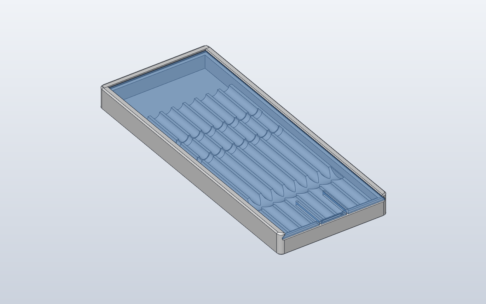

# T12 Tip Holder

A parametric box for Hakko-style T12 soldering tips, modelled in SolidCraft. The tips lie flat side by side, like pencils in a pencil box, under a sliding lid that clicks shut. Both parts print without supports.

The idea comes from `solderingTipT12.step`, a Gridfinity 4×1 bin for 5 tips: grooves Ø5.9 at a 7.4 mm pitch, with Ø6.7 pockets for the two collars. This design keeps that groove layout, drops the Gridfinity base, and adds the lid, a deep zone for bent tips and a configurable number of tips.

## Files

| File | What it is |
|---|---|
| `T12_Tip_Holder.sc` | **Main design**, fully parametric (bodies `Tip_Box` and `Lid`) |
| `T12_Box.3mf` | Box, print-ready (open side up) |
| `T12_Lid.3mf` | Lid, print-ready (already turned **top face down**) |
| `parameters.csv` | Parameter table exported from the design |
| `solderingTipT12.step` | Reference Gridfinity bin the idea came from (not used in the model) |
| `pictures/` | Render |
| `.build/` | `gen.py` writes the build script `t12.json`; `exp.json` exports the 3MF and CSV files; `flip3mf.py` turns the lid 3MF over |

## Size (8 tips)

69.2 × 169 × 13.6 mm. Box 72 g, lid 34 g (PLA/PETG density).

## How it works

- **Tips:** each tip lies in a half-depth groove (`tip_d` + 2·`clear` = Ø5.9), with the connector end at the front. The two collars sit in wider pockets (`ring_pd` Ø6.9, `ring_w` 4 mm long).
- **Bent tips:** the last `tip_zone` (25 mm) at the working end is an open trough down to the floor. `bend_h` (4 mm) is free above and below the shaft axis, so bent tips like the JL02 fit with the bend pointing up or down. Sideways bends may touch the next tip.
- **Finger scoop:** a shallow scoop across the bed near the connector ends lets you get a finger under a tip.
- **Sliding lid:** the lid (2.5 mm, `lid_t`) has dovetail edges: a 0.8 mm vertical land (`lid_land`, so no knife edge), then a 45° bevel. They run in matching ways in the side walls (0.3 mm clearance, `lid_c`). The lid top sits 1 mm below the box top (`lid_recess`), so the wall lip over it is solid. It slides in from the front, which is cut down to the ways. Its leading end has the same land and 45° bevel as the long edges, so it eases into the ways, and it tucks 2.3 mm (`lid_engage`) under a matching 45° lip in the back wall.
- **Click:** two slots in the lid's front end make a flexible tongue (`tongue_w` × `tongue_l`). A Ø1.2 bump under the tongue rides up a 45° ramp on the front wall and drops into a notch in the wall top when the lid is closed.
- **Edges for printing:** 45° chamfers on the box bottom edge (`foot_ch` 0.6, against elephant foot), the box top outer edge and the front wall top (`top_ch` 0.8), the wall's inner top edge above the lid (`lip_ch` 0.5), and the lid's front top edge, which is on its bed side (`lid_ch` 0.5). The outer vertical corners have a 3 mm radius (`corner_r`), and the slot roots by the tongue are rounded. Tuned for a Bambu Lab P1S.

## Printing

| Part | Orientation |
|---|---|
| `T12_Box.3mf` | Floor on the bed, open side up |
| `T12_Lid.3mf` | Top face on the bed (the 3MF is already turned over), so the click bump faces up and the dovetail edges are 45° overhangs |

No supports are needed. The box dovetail ways are 45° overhangs, and the grooves and pockets open upward.

## Changing it

Open `T12_Tip_Holder.sc` and change the parameters. The main ones are:

| Parameter | Default | Meaning |
|---|---|---|
| `tip_n` | 8 | Number of tips. The box width follows; tested with 3, 5, 8 and 10 |
| `tip_d` | 5 mm | Shaft diameter |
| `tip_len` | 157 mm | Overall tip length. The inner length is `tip_len` + 2·`end_clear` |
| `ring_d`, `ring_y1`, `ring_y2`, `ring_w` | 6 / 86 / 105.5 / 4 mm | Collar diameter, positions measured from the connector end, and pocket length |
| `clear` | 0.45 mm | Radial clearance around shaft and collars |
| `pitch` | 7.4 mm | Groove spacing |
| `tip_zone`, `bend_h` | 25 / 4 mm | Bent-tip zone length and room |
| `wall`, `lid_t`, `lid_c` | 4 / 2.5 / 0.3 mm | Wall, lid thickness, lid clearance |
| `lid_land`, `lid_recess`, `lip_ch` | 0.8 / 1 / 0.5 mm | Lid edge land, lid depth below the box top, chamfer on the wall's inner top edge |
| `foot_ch`, `top_ch`, `lid_ch` | 0.6 / 0.8 / 0.5 mm | Print chamfers: box bottom, box top and front wall top, lid front end |
| `click_r`, `tongue_w`, `tongue_l` | 0.6 / min(16, Wi/2) / 22 mm | Click strength and tongue size |

**Tip dimensions:** `tip_d`, `tip_len` and the collar positions come from the reference bin and from common T12 figures (about Ø5 shaft, about 155–157 mm long). They vary between makers, so measure one of your tips and adjust them before printing.

After a change, re-export the parts:

1. Run `.build/exp.json` on the design: `solidcraft-cli run exp.json --in T12_Tip_Holder.sc`.
2. Run `python3 .build/flip3mf.py T12_Lid.3mf`. The 3MF export does not apply the lid's print face, so this step turns the lid over.
